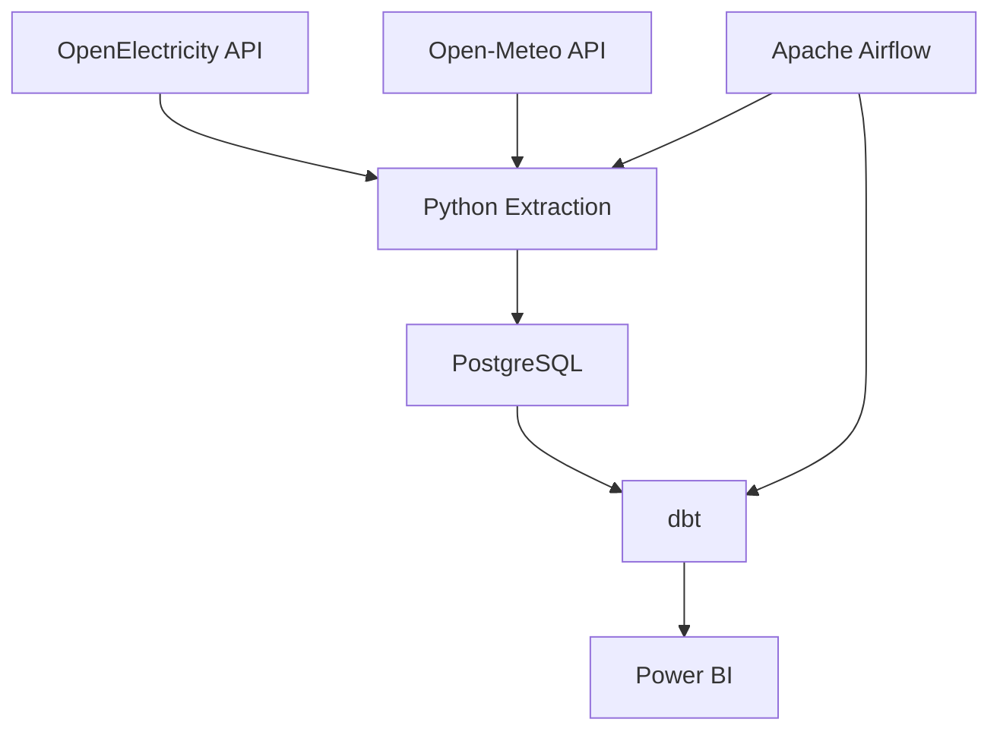
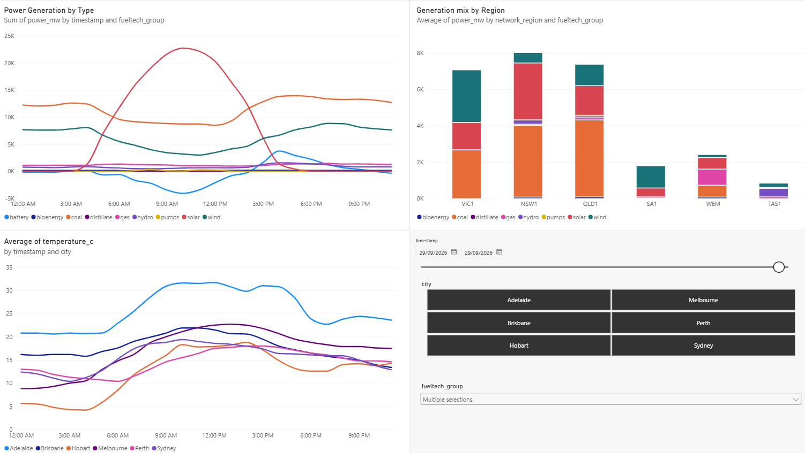

# Electricity and Weather ELT Pipeline

This project demonstrates an automated ELT (Extract, Load, Transform) pipeline for collecting, storing, transforming, and analysing electricity generation and weather data.

## Technology Stack

- **Extract:** Python scripts collect raw data from two public APIs.
- **Load:** Raw data is loaded into a PostgreSQL database.
- **Transform:** dbt (Data Build Tool) transforms the raw data into analysis-ready models.
- **Automation:** Apache Airflow orchestrates the ELT pipeline and refreshes the data daily.
- **Analysis:** Power BI is used to visualise and compare electricity and weather data.

## Data Sources

This project combines data from two public APIs:

OpenElectricity: Hourly electricity generation data for Australia's National Electricity Market (NEM) and Wholesale Electricity Market (WEM), including generation by region and fuel technology.

Open-Meteo: Hourly weather data for selected Australian cities, including temperature, precipitation, surface pressure, cloud cover, wind speed, and day/night status.

The datasets are aligned by timestamp so electricity generation can be analysed alongside weather conditions.

## Pipeline Architecture

The pipeline follows the following workflow:



Apache Airflow orchestrates the extraction and transformation steps, running the pipeline on a daily schedule.

The Python extraction script loads raw API data into PostgreSQL, where dbt then creates staging, intermediate, and final fact models for analysis in Power BI.

## Project Structure

``` text
Electricity_ELT/
├── airflow/
│   └── dags/
│       └── electricity_pipeline.py
├── dbt/
│   ├── models/
│   │   ├── stg_electricity.sql
│   │   ├── stg_weather.sql
│   │   ├── int_elec_weath.sql
│   │   ├── fact_electricity_weather.sql
│   │   └── sources.yml
│   └── dbt_project.yml
├── extract.py
├── Main_dashboard.pbix
├── .env.example
├── .gitignore
└── README.md
```

- **extract.py** handles API extraction and loading into PostgreSQL.
- **airflow/dags/electricity_pipeline.py** orchestrates extraction and dbt transformations.
- **dbt/models/** contains staging, intermediate, and final analytical models.
- **Main_dashboard.pbix** contains the Power BI report.
- **.env.example** documents the required environment variables without exposing credentials.

## How It Works

1. Apache Airflow triggers the pipeline on a daily schedule.
2. extract.py requests the latest electricity and weather data from the OpenElectricity and Open-Meteo APIs.
3. The raw data is loaded into PostgreSQL using upserts so overlapping extraction windows do not create duplicate records.
4. dbt transforms the raw tables through staging and intermediate models into a final fact table.
5. Power BI connects to the transformed data for analysis and visualisation.

## dbt Model Layers

The dbt project separates transformation logic into three layers:

- **Staging:** Cleans and standardises the raw electricity and weather data.
- **Intermediate:** Joins the electricity and weather datasets using timestamp and location-related fields.
- **Fact:** Produces the final analysis-ready table used by Power BI.

This structure keeps transformation logic modular and makes each stage of the data model easier to test and maintain.

## Dashboard and Analysis

Power BI is used to explore the transformed dataset and compare electricity generation with weather conditions.

The dashboard includes:

- Electricity generation by fuel technology over time.
- Generation mix by region.
- Temperature trends by city.
- Interactive slicers for date, city, and fuel technology.

The dashboard is intended to support exploratory analysis of relationships between electricity generation patterns and weather conditions.



## Setup

To run the project locally:

1. Install Python, PostgreSQL, dbt, and Apache Airflow.
2. Create the required PostgreSQL database and dbt profile.
3. Copy .env.example to .env and add the required API key, database password, and local paths.
4. Run extract.py to load raw data into PostgreSQL.
5. Run dbt run from the dbt project directory to build the transformed models.
6. Start Apache Airflow and enable the electricity_pipeline DAG for scheduled execution.
7. Open Main_dashboard.pbix in Power BI Desktop and refresh the data.

## Notes and Limitations

- This project is implemented as a local development pipeline rather than a cloud-hosted production deployment.
- PostgreSQL, Airflow, and Power BI currently run locally.
- Power BI refresh is performed manually in Power BI Desktop.
- Local environment settings and credentials are excluded from the repository.
- The pipeline uses overlapping extraction windows and database upserts to reduce the risk of missing delayed API data.